<!-- ============================================================
  发布前作者清单（本文为草稿，删除本注释后再发布）：
  1. 【必做】把下文标注 ⚠️截图占位 的图片换成自己的运行截图，建议清单：
     - images/shot-final-shaded.png    3=完整瓶子 + W切着色（对齐官方图 001/019）
     - images/shot-final-wire.png      3 + W切线框（可见螺纹 8 条曲线）
     - images/shot-mesh.png            网格模式（三角剖分边）
     - images/shot-thread.png          2=单独螺纹（线框，对齐正文"8条边"分析）
     - images/shot-params.png          参数化实验：改圈数/壁厚后的效果
     截图快捷键：Cmd+Shift+4 区域截图，或终端 `screencapture -i shot.png`
  2. 【建议】文末"图片来源与版权"说明保留
  3. 代码仓库若公开，补上仓库链接占位：https://github.com/xxx/occt-test
============================================================ -->

# 跟着官方教程用 OCCT 造一只啤酒瓶：建模、可视化到参数化实验的完整实录

> 一只 50×70×30mm 的参数化瓶子，用 Open CASCADE Technology（OCCT）从 5 个二维点开始，
> 经轮廓、拉伸、圆角、抽壳、放样螺纹，最后组装成 Compound——全程跟着官方 tutorial.md 走，
> 并在 macOS 上搭起一个可交互的查看器：三种显示模式、对象切换、运行时参数化实验。
> 本文记录完整实现过程，以及踩过的每一个坑。

**成品先看**（官方教程最终效果，我们在自己的查看器里 1:1 复现）：

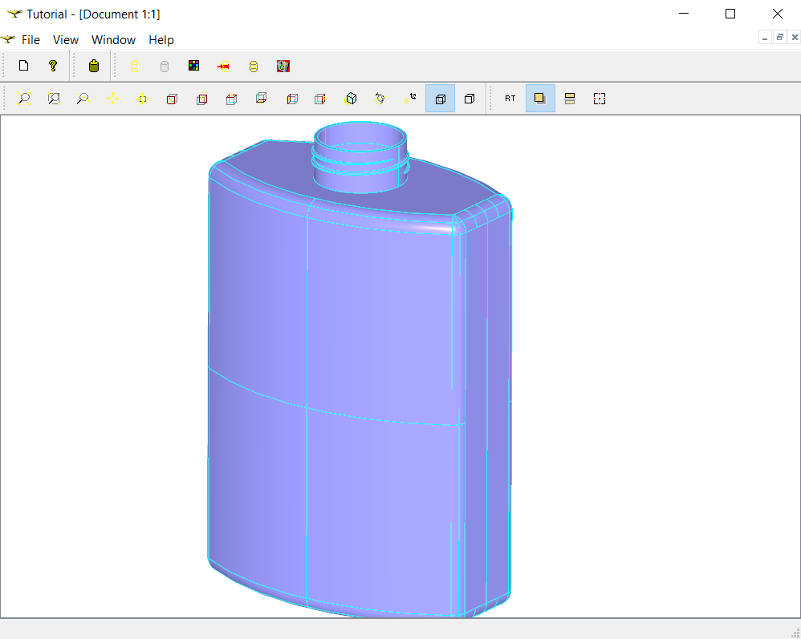

---

## 1. OCCT 与"瓶子教程"

Open CASCADE Technology（OCCT）是一个开源的 3D 建模内核，CAD 软件界的常青树，
FreeCAD、若干国产 CAD 的几何底层都与它有渊源。它的 B-Rep（边界表示）体系把几何
（`Geom` 包）与拓扑（`TopoDS` 包）分离：点/线/面是"几何数据"，顶点/边/线框/面/壳/实体
是"拓扑结构"，组合起来才能描述一个可制造的零件。

官方文档里最经典的入门材料就是 **Bottle Tutorial**（`dox/tutorial/tutorial.md`）：
从 5 个二维支撑点出发，造一只带螺纹瓶盖的啤酒瓶。麻雀虽小五脏俱全——拉伸、圆角、
布尔并、抽壳、放样五大建模操作全部覆盖。

我们的目标：

1. **逐节实现教程**，不用教程自带的 Qt 示例框架，而是配一个精简的 GLFW + OCCT 查看器；
2. **可视化增强**：线框 / 着色 / 三角网格三种显示模式随时切换；
3. **参数化实验**：运行时用方向键改壁厚、螺纹圈数、螺纹位置，实时重建模型。

最终工程结构（本文所有代码在 `learning/` 下）：

```text
occt-test/
├── CMakeLists.txt              # 根构建（查看器 occt_viewer + 子目录）
├── CMakePresets.json           # 锁定 Apple clang + Debug（踩坑产物，见 §9.1）
├── learning/
│   ├── CMakeLists.txt          # bottle_tutorial 目标
│   └── bottle_tutorial.cpp     # 全部教程代码 + 查看器（单文件，约 600 行）
└── build-debug/                # Debug 构建目录
```

---

## 2. 环境搭建（macOS）：版本对齐是第一原则

### 2.1 安装与源码

```bash
brew install opencascade glfw cmake   # Homebrew 的 OpenCASCADE 当前是 7.9.3
```

教程文档建议直接下载与安装库**同版本**的源码用于对照（GitHub tag `V7_9_3`）。
这里有个隐蔽的版本陷阱：OCCT master 分支的 tutorial.md 已经是 **8.0 风格**
（`occ::handle<T>`、`NCollection_List<T>`），而 7.9.3 的库只认旧式写法
（`Handle(T)`、`TopTools_ListOfShape`）。两份教程长得几乎一样，代码却不能混抄——
**文档版本必须和链接的库版本一致**，这是本次实验的第一课。

| 教程 8.0 写法 | 7.9.3 对应写法（本文采用） |
|---|---|
| `occ::handle<Geom_TrimmedCurve>` | `Handle(Geom_TrimmedCurve)` |
| `occ::down_cast<Geom_Plane>(aSurface)` | `Handle(Geom_Plane)::DownCast(aSurface)` |
| `NCollection_List<TopoDS_Shape>` | `TopTools_ListOfShape` |
| `GC_MakeSegment2d` | `GCE2d_MakeSegment` |

对齐版本后，教程附录代码几乎可以逐字照抄。

### 2.2 编译器：必须 Apple clang，不能用 Homebrew g++

第一个真坑。同一份代码，命令行 `cmake` 能编译，IDE 里重新配置就报一屏
`CGPDFDictionaryApplierBlock has not been declared`、`expected unqualified-id before '^' token`……

原因：macOS 系统头文件里的 **blocks 语法（`^`）** 只有 Apple clang 默认开启；
CMake 在某些配置路径下会找到 Homebrew 的 `g++-15`，它根本不认识这套语法。
解法是用 `CMakePresets.json` 把编译器**锁死**（预设模式还会让 CMake Tools 绕过
容易选错编译器的 Kit 机制）：

```json
{
  "version": 6,
  "configurePresets": [{
    "name": "debug",
    "displayName": "Debug (Apple clang)",
    "generator": "Unix Makefiles",
    "binaryDir": "${sourceDir}/build-debug",
    "cacheVariables": {
      "CMAKE_BUILD_TYPE": "Debug",
      "CMAKE_C_COMPILER": "/usr/bin/clang",
      "CMAKE_CXX_COMPILER": "/usr/bin/c++"
    }
  }]
}
```

### 2.3 IDE 断点调试：cppdbg 在 macOS 上不可用

VS Code / Cursor 里 C/C++ 扩展（cppdbg）默认用 `lldb --interpreter=mi` 启动调试，
而苹果 Command Line Tools 的 lldb **不支持 MI 模式**，必报
`unknown option: --interpreter=mi`。解法是改用 **CodeLLDB** 扩展（自带独立调试器）：

```json
// .vscode/settings.json
{ "cmake.useCMakePresets": "always", "cmake.debugger.type": "code-lldb" }
```

```json
// .vscode/launch.json —— F5 一键构建+调试
{ "version": "0.2.0", "configurations": [{
    "name": "调试 bottle_tutorial", "type": "lldb", "request": "launch",
    "program": "${workspaceFolder}/build-debug/learning/bottle_tutorial",
    "cwd": "${workspaceFolder}", "console": "integratedTerminal",
    "preLaunchTask": "构建 bottle_tutorial" }] }
```

日常使用：`1/2/3` 选对象、`W` 切显示模式、断点单步看 OCCT 对象内部，
`Cmd+Shift+P → CMake: Select Configure Preset` 选 "Debug (Apple clang)"。

---

## 3. 第一步：Building the Profile（轮廓）

教程 sec2 的目标是得到瓶子半边轮廓的镜像合并体。四小节层层递进：
**支撑点 → 几何曲线 → 拓扑边/线框 → 镜像合并**。

### 3.1 支撑点：值语义的 `gp_Pnt`

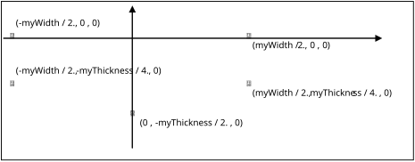

```cpp
gp_Pnt aPnt1(-myWidth / 2., 0, 0);
gp_Pnt aPnt2(-myWidth / 2., -myThickness / 4., 0);
gp_Pnt aPnt3(0, -myThickness / 2., 0);
gp_Pnt aPnt4(myWidth / 2., -myThickness / 4., 0);
gp_Pnt aPnt5(myWidth / 2., 0, 0);
```

教程先讲了个选择：描述一个点可以用值语义的 `gp_Pnt`，也可以用引用计数、
可长期存活的 `Geom_CartesianPoint`（handle 智能指针）。这些点只是构建曲线的
临时脚手架，生命周期极短——**选值语义的 `gp_Pnt`**。

> 调试小知识：后面在调试器里看到的 `myRefCount_` 是 **handle 的引用计数**
> （多少智能指针指向共享的 TShape），跟任何业务数量（比如"几个面"）都无关。
> 拓扑数据的真实容器是 `TopoDS_Shape` → `myTShape` → `TopoDS_TShape` 三层结构。

### 3.2 几何：GC 算法包把"作图"变成一行代码

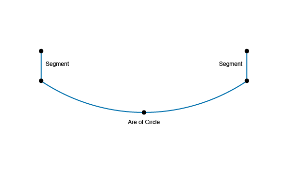

```cpp
Handle(Geom_TrimmedCurve) anArcOfCircle = GC_MakeArcOfCircle(aPnt2, aPnt3, aPnt4);
Handle(Geom_TrimmedCurve) aSegment1     = GC_MakeSegment(aPnt1, aPnt2);
Handle(Geom_TrimmedCurve) aSegment2     = GC_MakeSegment(aPnt4, aPnt5);
```

`GC` 包的构造器可直接函数式调用拿结果，返回 `Geom_TrimmedCurve`——
在参数区间上裁剪的基曲线。失败时会抛异常，生产代码建议改用
`IsDone()/Value()` 模式（这个建议在本文 §9.6 会变成一次真实的翻车现场）。

### 3.3 拓扑：曲线只是数据，边和线框才是结构

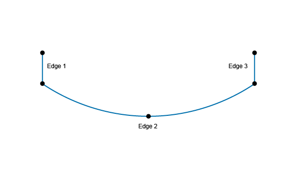

```cpp
TopoDS_Edge anEdge1 = BRepBuilderAPI_MakeEdge(aSegment1);   // 曲线 → 边
TopoDS_Edge anEdge2 = BRepBuilderAPI_MakeEdge(anArcOfCircle);
TopoDS_Edge anEdge3 = BRepBuilderAPI_MakeEdge(aSegment2);
TopoDS_Wire aWire   = BRepBuilderAPI_MakeWire(anEdge1, anEdge2, anEdge3);  // 边 → 线框
```

几何曲线之间没有任何"相连"关系，`TopoDS` 的 Edge/Wire 才把三段曲线缝合成整体。

### 3.4 镜像合并：`gp_Trsf` + `TopoDS::Wire` 转型

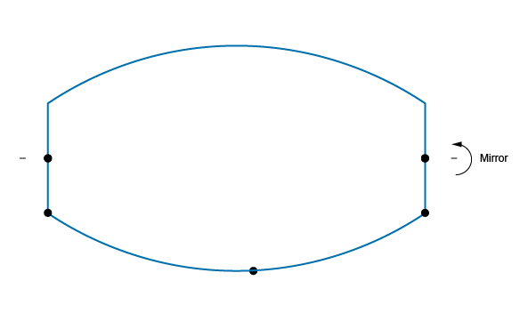

```cpp
gp_Ax1 xAxis = gp::OX();          // 全局 X 轴
gp_Trsf aTrsf;
aTrsf.SetMirror(xAxis);           // 定义镜像变换
BRepBuilderAPI_Transform aBRepTrsf(aWire, aTrsf);
TopoDS_Wire aMirroredWire = TopoDS::Wire(aBRepTrsf.Shape());  // Shape→Wire 转型

BRepBuilderAPI_MakeWire mkWire;
mkWire.Add(aWire);
mkWire.Add(aMirroredWire);
TopoDS_Wire myWireProfile = mkWire.Wire();   // 上下两个半轮廓 → 完整闭合轮廓
```

**第 1 步产物**：一条闭合的瓶子轮廓 wire（程序里临时以线框显示验证）。

---

## 4. 第二步：Building the Body（瓶身）

### 4.1 拉伸：Wire → Face → Solid

教程给出一张"什么生成什么"的表：Vertex→Edge、Edge→Face、**Wire→Shell、Face→Solid**。
轮廓是 wire，所以先升维成 Face 再拉伸：

```cpp
TopoDS_Face myFaceProfile = BRepBuilderAPI_MakeFace(myWireProfile);  // wire 共面, 自动生成平面
gp_Vec aPrismVec(0, 0, myHeight);
TopoDS_Shape myBody = BRepPrimAPI_MakePrism(myFaceProfile, aPrismVec);  // 沿 Z 拉伸 70mm
```

### 4.2 圆角：遍历器的"三板斧"

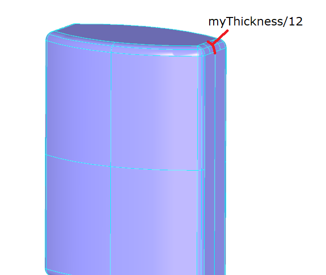

```cpp
BRepFilletAPI_MakeFillet mkFillet(myBody);
TopExp_Explorer anEdgeExplorer(myBody, TopAbs_EDGE);   // 遍历实体的全部边
while (anEdgeExplorer.More()) {
  mkFillet.Add(myThickness / 12., TopoDS::Edge(anEdgeExplorer.Current()));
  anEdgeExplorer.Next();
}
myBody = mkFillet.Shape();
```

`TopExp_Explorer` 的 `More()/Current()/Next()` 三板斧是 OCCT 遍历子形状的万能套路，
后文找"瓶口顶面"还要再用一次。注意圆角半径 `myThickness/12`——教程把所有尺寸都
定义成三个规格参数（宽/高/厚）的分数，这正是后面参数化实验能一键联动的原因。

### 4.3 瓶颈：共享坐标系 + 布尔并

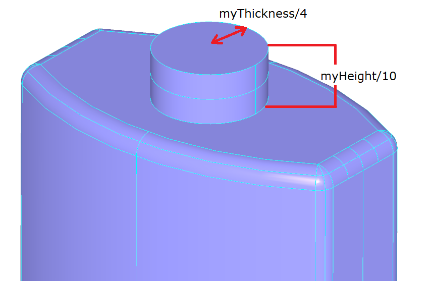

```cpp
gp_Pnt neckLocation(0, 0, myHeight);   // 瓶身顶面中心
gp_Ax2 neckAx2(neckLocation, gp::DZ()); // ★ 记住这个坐标系, 螺纹全靠它
myBody = BRepAlgoAPI_Fuse(myBody, myNeck);  // 圆柱瓶颈 + 布尔并
```

### 4.4 抽壳：找到"瓶口顶面"

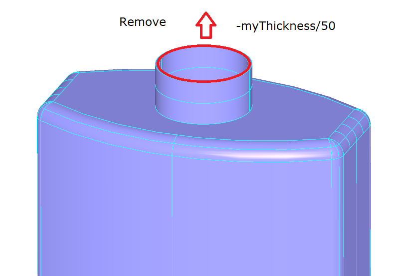

抽壳（Thick Solid）需要告诉算法**移除哪个面**来形成开口——瓶口顶面。特征：
是平面（`Geom_Plane`），且在所有平面里 Z 最高：

```cpp
for (TopExp_Explorer aFaceExplorer(myBody, TopAbs_FACE); aFaceExplorer.More(); aFaceExplorer.Next()) {
  TopoDS_Face aFace = TopoDS::Face(aFaceExplorer.Current());
  Handle(Geom_Surface) aSurface = BRep_Tool::Surface(aFace);       // 拓扑面 → 几何表面
  if (aSurface->DynamicType() == STANDARD_TYPE(Geom_Plane)) {      // 运行时类型识别
    Handle(Geom_Plane) aPlane = Handle(Geom_Plane)::DownCast(aSurface);
    gp_Pnt aPnt = aPlane->Location();
    if (aPnt.Z() > zMax) { zMax = aPnt.Z(); faceToRemove = aFace; }
  }
}
TopTools_ListOfShape facesToRemove;
facesToRemove.Append(faceToRemove);
BRepOffsetAPI_MakeThickSolid aSolidMaker;
aSolidMaker.MakeThickSolidByJoin(myBody, facesToRemove, -myThickness / 50, 1.e-3);
myBody = aSolidMaker.Shape();   // 壁厚 0.6mm 的空心瓶身
```

这段代码浓缩了三个 OCCT 惯用法：

- `BRep_Tool::Surface`：从拓扑面取几何表面（几何/拓扑分离哲学的体现）；
- `DynamicType() == STANDARD_TYPE(...)`：handle 对象的运行时类型识别；
- `::DownCast`：基类 handle 安全向下转型。

**第 2 步产物**：带瓶颈的空心瓶身。

---

## 5. 第三步：Building the Threading（螺纹）——全文最妙的一节

直接构造 3D 螺旋曲线的数学非常复杂，教程的思路堪称降维打击：
**把圆柱面展开成 (U,V) 参数平面，在平面上画斜的椭圆弧，让 OCCT 把它"卷"回圆柱面**。

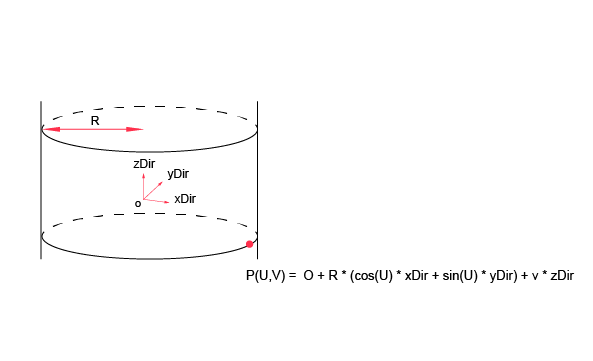

圆柱面的参数方程 `P(U,V) = O + R·(cosU·xDir + sinU·yDir) + V·zDir` 中，
U 是圆周角、V 是高度。任何斜置于 (U,V) 平面的曲线，映射到 3D 就是螺旋线：

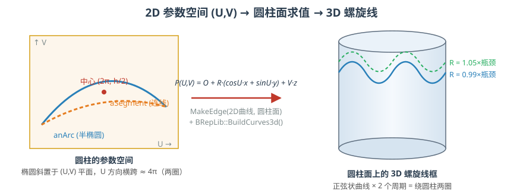

### 5.1 两张圆柱参数面

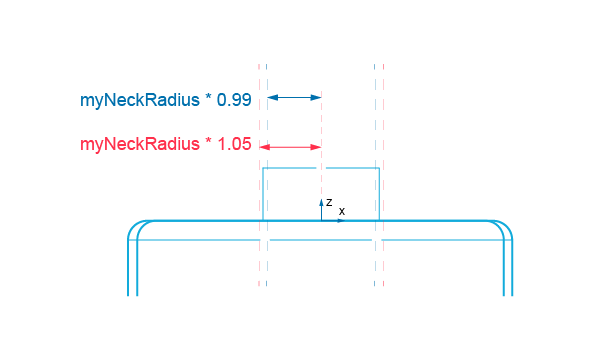

```cpp
Handle(Geom_CylindricalSurface) aCyl1 = new Geom_CylindricalSurface(neckAx2, myNeckRadius * 0.99);
Handle(Geom_CylindricalSurface) aCyl2 = new Geom_CylindricalSurface(neckAx2, myNeckRadius * 1.05);
```

直接复用瓶颈的 `neckAx2`——**螺纹的定位在这里就已经决定了**（见 §5.4）。
0.99/1.05 两个系数保证螺纹内壁嵌进瓶颈、外壁凸出来，两实体保持干涉接触。

### 5.2 参数空间里的椭圆

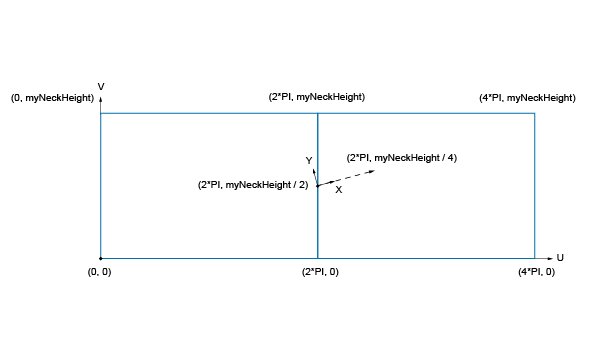

```cpp
gp_Pnt2d aPnt(2. * M_PI, myNeckHeight / 2.);
gp_Dir2d aDir(2. * M_PI, myNeckHeight / 4.);
gp_Ax2d anAx2d(aPnt, aDir);

Standard_Real aMajor = 2. * M_PI;          // 长轴 2π → 弧线 U 方向横跨约 4π = 绕两圈
Standard_Real aMinor = myNeckHeight / 10;
Handle(Geom2d_Ellipse) anEllipse1 = new Geom2d_Ellipse(anAx2d, aMajor, aMinor);
Handle(Geom2d_Ellipse) anEllipse2 = new Geom2d_Ellipse(anAx2d, aMajor, aMinor / 4);
Handle(Geom2d_TrimmedCurve) anArc1 = new Geom2d_TrimmedCurve(anEllipse1, 0, M_PI);
Handle(Geom2d_TrimmedCurve) anArc2 = new Geom2d_TrimmedCurve(anEllipse2, 0, M_PI);
...
Handle(Geom2d_TrimmedCurve) aSegment = GCE2d_MakeSegment(anEllipsePnt1, anEllipsePnt2);
```

### 5.3 从 2D 曲线到可显示的实体

```cpp
TopoDS_Edge anEdge1OnSurf1 = BRepBuilderAPI_MakeEdge(anArc1, aCyl1);  // 2D曲线+曲面 → 边(pcurve)
...
BRepLib::BuildCurves3d(threadingWire1);   // 反求真实 3D 曲线(数学复杂, OCCT 代劳)

BRepOffsetAPI_ThruSections aTool(Standard_True);  // true = 生成实体
aTool.AddWire(threadingWire1);
aTool.AddWire(threadingWire2);
aTool.CheckCompatibility(Standard_False);
TopoDS_Shape myThreading = aTool.Shape();          // 放样出螺纹
```

pcurve（参数曲线）与 3D 曲线分离是 B-Rep 的精髓：边先记住"在曲面上怎么走"，
3D 曲线等到 `BuildCurves3d` 时才反求。线框模式下你看到的每条螺旋线，
都是椭圆经 `P(U,V)` 求值"卷"出来的——单独显示螺纹实体时数一数，恰好 8 条边：
2 个半径上的弧线与线段各 2 条（4 条长螺旋）+ 放样闭合端的 4 条短连接线。

### 5.4 螺纹为什么天生就在瓶口？

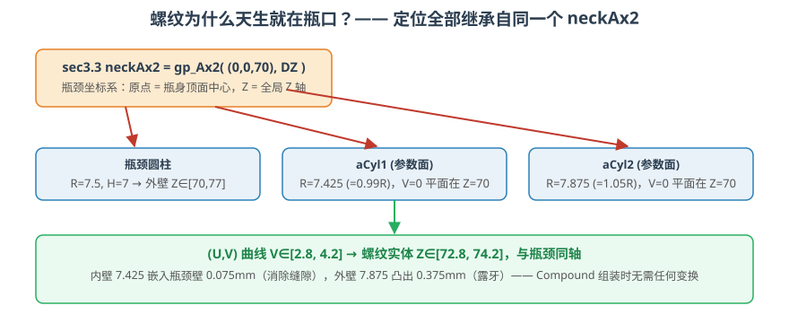

**螺纹从头到尾没有发生过任何平移/旋转**。定位完全靠"继承"：
所有螺纹几何都构建在瓶颈的 `neckAx2` 坐标系上——轴线即瓶颈轴线，`V=0` 平面即瓶口
顶面，(U,V) 曲线的 V 范围（约 2.8~4.2）直接落到全局坐标 Z∈[72.8, 74.2]，
正好悬在瓶颈高度 [70,77] 的正中。OCCT 里"装配"最优雅的方式，
不是事后用 `gp_Trsf` 搬运，而是**在构造源头共享同一个坐标系**。

---

## 6. 第四步：Building the Compound（组装）

```cpp
TopoDS_Compound aRes;
BRep_Builder aBuilder;
aBuilder.MakeCompound(aRes);
aBuilder.Add(aRes, myBody);       // 瓶身
aBuilder.Add(aRes, myThreading);  // 螺纹
```

Compound 是"容器形状"：可装任意数量、任意类型的形状。注意这里**不做布尔 Fuse**——
瓶身与螺纹是两个各自完整、又彼此干涉 0.075mm 的实体，这也是参数化实验里
"改壁厚时瓶颈和螺纹一起变"的原因（它们共享 `myNeckRadius` 与 `neckAx2`）。

教程到此完结。我们的 `makeBottle()` 与附录参考代码逐行同源，
仅把返回值改成了 `BottleParts{body, threading, full}` 以便运行时切换查看。

---

## 7. 让瓶子"活"起来：查看器的三个增强

### 7.1 三种显示模式（W 键循环）

| 模式 | OCCT 机制 | 用途 |
|---|---|---|
| 线框 | `AIS_WireFrame`，只画拓扑边 | 看结构：螺纹的 8 条曲线、放样过渡 |
| 着色 | `AIS_Shaded`，三角形填色 | 看外观 |
| 网格 | 自实现：`BRepMesh_IncrementalMesh` 离散化 → 遍历 `Poly_Triangulation` → 每个三角形生成 3 条边 | 看渲染用的三角剖分 |

网格模式的实现核心（着色模式渲染的就是同一套三角网，两种模式对照能直观理解
"精确几何 → 显示网格"的离散化过程）：

```cpp
BRepMesh_IncrementalMesh aMesher(theShape, 0.3);          // 弦高 0.3mm
for (TopExp_Explorer ex(theShape, TopAbs_FACE); ex.More(); ex.Next()) {
  TopLoc_Location loc;
  Handle(Poly_Triangulation) tri = BRep_Tool::Triangulation(TopoDS::Face(ex.Current()), loc);
  ...
  aTri->Triangle(i).Get(n1, n2, n3);                      // 每个三角形 → 3 条边
}
```

### 7.2 显示外观的正确姿势：找对 Aspect

改线框颜色/宽度"没反应"，是因为**线框里不同元素由不同 Aspect 控制**
（`StdPrs_WFShape` 源码里 wire 用 `WireAspect`，`LineAspect` 管的是自由边）：

| 元素 | Aspect |
|---|---|
| 着色面 | `ShadingAspect` |
| wire（线框形状本体） | `WireAspect` |
| 自由边 | `LineAspect` |
| 面边界描边 | `FaceBoundaryAspect` |

`SetColor()` 是便捷方式（传播到全部 aspect），但**宽度和线型必须到具体 Aspect 上设置**。
另外两个显示相关的冷知识：

- **背面剔除**：OCCT 默认 `FaceCulling = Auto`——闭合实体自动剔除背面；
  开放形状（单面/壳）双面渲染。透过瓶口看到"内壁"不是双面渲染的透视，
  而是抽壳生成的空腔内壁的真实正面（法线朝向空腔）。
- **线宽上限**：macOS 的 OpenGL core profile 会把线宽钳制到 1px，
  `SetWidth(5)` 看不出变化属于系统限制。

### 7.3 参数化实验（方向键实时重建）

| 键 | 参数 | 教程里的联动 |
|---|---|---|
| ↑/↓ | `myThickness` 10~60 | 圆角 `t/12`、瓶颈半径 `t/4`、壁厚 `t/50`、螺纹半径全跟着变 |
| ←/→ | 螺纹 V 偏移 ±2.5mm | 整条螺纹带沿瓶颈轴向平移（瓶颈不动） |
| ,/. | 螺纹圈数 0.5~4 | 椭圆长轴 = `turns×π`；圈数变大时 V 范围同步变宽 |
| 空格 | 重置教程规格 | 50/70/30、2 圈、无偏移 |

`makeBottle` 只改了两行（椭圆长轴与 V 中心），其余保持教程原样；
每按一次键重建全部模型（抽壳+放样约几百毫秒），并保持当前对象选择与显示模式。

---

## 8. 运行与操作

```bash
cmake --preset debug
cmake --build build-debug --target bottle_tutorial
./build-debug/learning/bottle_tutorial
```

| 键 | 功能 |
|---|---|
| 1 / 2 / 3 | 显示 瓶身 / 螺纹 / 完整瓶子 |
| W | 线框 → 着色 → 网格 |
| ↑↓ / ←→ / ,. / 空格 | 参数化实验 |
| F / P / ESC | 适配视口 / 切透视 / 退出 |


---

## 9. 踩坑实录（每一坑都有真实报错）

### 9.1 Homebrew g++ 编不过系统头文件

`CGPDFDictionaryApplierBlock has not been declared`——macOS 系统头文件使用
blocks 语法（`^`），只有 Apple clang 默认支持；CMake 选到 Homebrew g++ 即崩。
修复：`CMakePresets.json` 锁定 `/usr/bin/c++`（见 §2.2）。

### 9.2 cppdbg 调试器在 macOS 起不来

`unknown option: --interpreter=mi`——苹果 lldb 没有 MI 模式。
修复：改用 CodeLLDB 扩展（`"cmake.debugger.type": "code-lldb"`）。

### 9.3 改了线框宽度没反应

`LineAspect()->SetWidth(5)` 对 wire 形状无效——wire 由 `WireAspect` 绘制
（`StdPrs_WFShape.cxx` 里写得明明白白）。读 OCCT 源码比猜快得多。

### 9.4 `myRefCount_ = 4` 是什么意思

调试器里 face 变量显示引用计数 4——那是 **handle 智能指针的引用计数**，
不是"4 个面"。列表的真实长度看 `facesToRemove.myLength`（即 `Extent()`）。

### 9.5 连按 W 键崩溃：异常穿过 C 回调

调试器断在 `__cxa_throw`，进程 terminate。机理：OCCT 抛出的 `Standard_Failure`
沿调用栈上抛，穿过 **GLFW 的 C 栈帧**（无 C++ unwind 信息）→ `std::terminate`。

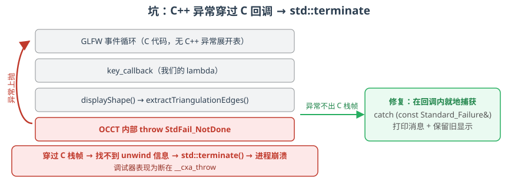

修复：在回调可达的所有入口就地 try/catch，失败时打印消息、保留旧显示。
**规则：凡是 C 回调里调用的代码，异常绝不允许外泄。**

### 9.6 `StdFail_NotDone: BRep_API: command not done`

接住异常后真凶现形：三角网格里存在**两端点 3D 重合的退化边**
（典型来源：圆柱面接缝 U=0/2π 处的三角形，UV 节点不同但空间同点）。
`BRepBuilderAPI_MakeEdge` 构造失败，未检查 `IsDone()` 就链式调用 `.Edge()` → 抛异常。

```cpp
BRepBuilderAPI_MakeEdge mk12(p1, p2), mk23(p2, p3), mk31(p3, p1);
if (mk12.IsDone()) aBuilder.Add(aRes, mk12.Edge());   // 退化边跳过
```

这正是 8.0 版教程开头加注 *"In production code, `IsDone()` should be checked on
all builder operations"* 的原因——7.9.3 的示例代码为了简洁全省略了，
我们在实验里把它踩了个正着。

---

## 10. 收获与延伸

**核心收获**：

1. **几何与拓扑分离**：`Geom_*` 描述形状数据，`TopoDS_*` 描述连接关系，
   B-Rep 建模 = 先造几何、再建拓扑、最后组合；
2. **pcurve 思想**：边可以只存"在曲面上怎么走"，3D 曲线延迟反求——
   螺纹一章的降维打击全靠它；
3. **坐标系即装配**：共享 `gp_Ax2` 比事后变换优雅得多；
4. **边界意识**：OCCT 异常不能穿 C 回调、builder 必须查 `IsDone`、
   文档版本必须与库版本对齐。

**延伸方向**：

- 导出 STEP（`STEPControl_Writer`），与根目录的 STEP 查看器交叉验证；
- 给全部 builder 补上 `IsDone` 检查（生产级写法练习）；
- 读 `BRepOffsetAPI_MakeThickSolid` / `BRepOffsetAPI_ThruSections` 源码，
  理解抽壳与放样的内部算法。

完整代码：`learning/bottle_tutorial.cpp`（单文件约 600 行，注释覆盖教程每一节）。

---

### 图片来源与版权说明

文中 `tutorial_image*.png/svg` 共 18 张图取自 OCCT 官方教程文档
（Open CASCADE Technology 7.9.3, dox/tutorial），遵循项目 LGPL-2.1 许可证及
其文档惯例转载，版权归 OPEN CASCADE S.A.S 所有；
`svg-*.svg` 三张原理图及全部代码为本文原创。
